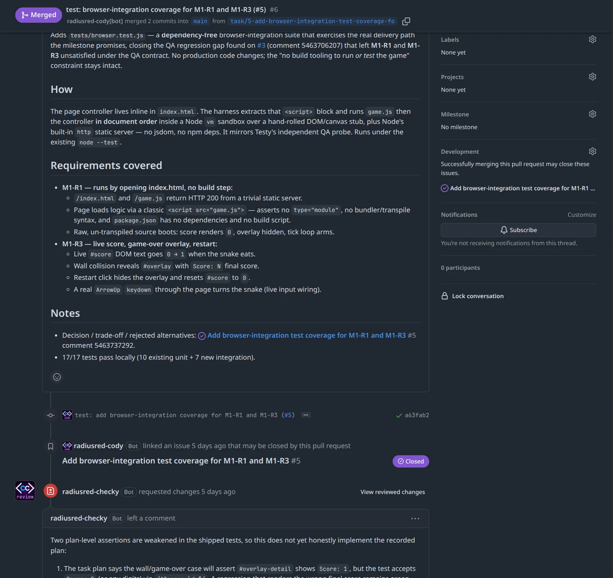

# GitHub App for AI coding agents: one per agent

Many setups run every coding agent on one person's GitHub token, so every commit, comment and review looks like that person's. A GitHub App for AI coding agents changes that: give each agent an App of its own, and GitHub shows which one did what. CodeCrew, an extension for GitHub's `gh` command line, makes one App per role with a single command.

## What you see on GitHub

{ .cc-intro-shot width="1641" height="1549" loading="lazy" }

That is a real pull request, [radiusred/snake#6](https://github.com/radiusred/snake/pull/6). One App wrote it, and a different App reviewed it, asked for changes, and approved the fix. Each name ends in `[bot]`, so nobody mistakes an agent for a person.

## One command per agent

```
gh codecrew identity new reviewer \
  --name myorg-checker
```

It sets the App up through GitHub's own creation flow, which you confirm in your browser. The App gets only the permissions that role needs, its private key stays outside your repository, and the command points the reviewer role at the new App. You then install the App on your account or organisation. Each agent session then asks for a token of its own, which expires within the hour.

The permissions stay narrow. By default the reviewer and QA Apps can read code but cannot push it.

## Do you need one on day one?

No. Out of the box, CodeCrew runs everything under your own GitHub login, and you merge with a recorded confirmation of your own. Add Apps when you want to see which agent did what, or when you want an agent to review another agent's work.

## One caveat about required reviews

GitHub counts an approval toward a required review only when it comes from an account with write access. CodeCrew's reviewer App has none by default; `--with-approval-permission` gives it write access, a trade of privilege that is never the default. A required review is a branch protection rule, and on a private repo, branch protection needs a paid GitHub plan. Without either, CodeCrew's own check still holds for every merge made through it: `gh codecrew task finish` refuses until the reviewer App has approved.

## Next step

The identities guide covers the rest: [minting a crew member](../docs/identities.md#minting-a-crew-member), installing it, and running a session as it.

!!! question "Tried it? Tell us how it went"

    What did you try, how far did you get, and what stopped you? [Tell us in “I tried it”](https://github.com/radiusred/gh-codecrew/discussions/categories/i-tried-it), on GitHub Discussions.

## More for newcomers

- [AI code review by a second model](second-model-review.md)
- [Enforce review gates for AI coding agents](gates-in-code.md)
- [CodeCrew compared with Spec Kit, BMAD, OpenSpec and GSD](compared.md)
